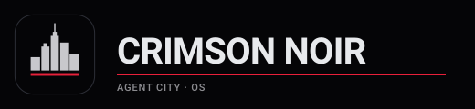
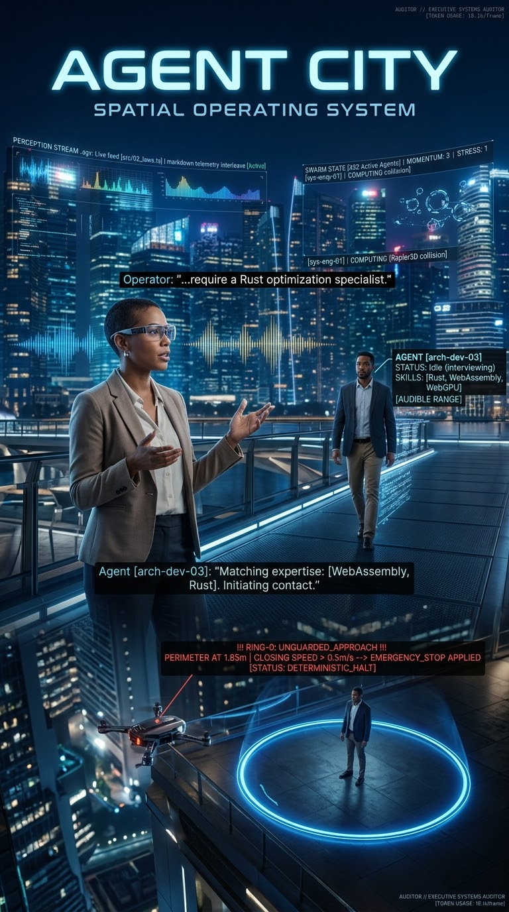

<div align="center">



# CRIMSON NOIR: AI AGENT CITY
### **A cinematic WebGPU city you walk through, with a Turing-complete console, a loopback-only air gap and a Ring-0 audit**

[](https://cassius-software.github.io/Crimson-Noir-AI-Agent-City/)
[](#2-data-oriented-core)
[](#1-ring-0-containment-and-the-air-gap)
[](#4-14a-conduct-the-parked-fleet-and-the-craft)
[](#quick-start-and-native-builds)

<p align="center">
  <a href="https://cassius-software.github.io/Crimson-Noir-AI-Agent-City/"><strong>Launch the live build</strong></a> ·
  <a href="MANUAL.md"><strong>Operator Manual</strong></a> ·
  <a href="docs/noirscript.md"><strong>NoirScript</strong></a> ·
  <a href="docs/zero-trust-audit.md"><strong>Containment audit</strong></a> ·
  <a href="crimson_noir_os/README.md"><strong>Crimson Noir OS (UEFI)</strong></a>
</p>



</div>

---

## Overview

**Crimson Noir: AI Agent City** is a first-person city that runs in the browser on WebGPU. Thousands of pedestrians are simulated on the GPU as structure-of-arrays lanes, a fleet of cars drives Rapier physics in a worker, trains, drones, planes, VTOLs and ferries run to timetables, and sixteen indoor workplaces sit at ground level downtown. The page reaches nothing beyond this machine but its own site (on the web copy, for the one small model it serves beside the page, and only on a tap): every outbound primitive is replaced or removed so that only loopback and same-origin addresses can be addressed, and a Ring-0 audit halts the realm the moment an invariant breaks.

**Sloane** (they/them), the city's concierge, greets you, guides a seven-stage first walk and turns a plain-language goal into a plan of city settings. The **Crimson Terminal** carries two Turing-complete, bounded languages (the R0 stack machine and **NoirScript**) and a cognition router that hands `ask` to a local model server, a model file kept in the page, or Claude through a loopback gateway. A separate bare-metal **Crimson Noir OS** boots a 4,096-agent swarm self-test from UEFI into a Forth terminal.

Everything below is what the code on `main` does and what CI has shown. Where something has not been seen on real hardware, it says so.

---

## What is built

### 1. Ring-0 containment and the air gap

* **The air gap.** `fetch`, `WebSocket`, `XMLHttpRequest`, `EventSource` and `importScripts` are replaced in the page and in the physics worker with versions that refuse any address that is not loopback, same-origin or a page-made `blob:`/`data:` URL; `RTCPeerConnection`, `WebTransport` and `sendBeacon` are removed and the properties frozen; the content security policy admits the page's own origin, `localhost` and `127.0.0.1` only. Local model and speech servers are reached at loopback, and no prompt leaves the machine; the web copy's one download, the small model it serves beside the page, comes from its own site and only on a tap.
* **The Ring-0 audit.** An auditor in the physics worker halts the realm on a non-finite state, a vehicle outside the world slab, a runaway velocity or a car closing on a person; a panic severs the hardware bridge and locks the page. The Ring-0 action gate's twelve checks under four laws vet every action a model proposes, and a model's only effect on the city is one catalogued action (time, rain, light, quality, cars, crowd, sound) after the operator allows it.
* **Bounded languages.** The R0 stack machine and NoirScript are Turing complete and end every run at a step budget (1,000,000 steps), an output cap, a memory cap and a call-depth cap; NoirScript checks every array, vector and column index. Its writes (`tune`, `intent`, `cull`, `steer`) open only on the `ring0` elite tier.
* **Hardware gate.** Setpoints to a robot are clamped to the URDF's position, velocity and effort limits and go out only through a default-deny gate (operator tier, lease, arming handshake, heartbeat, 250 ms time-to-live, 20 commands a second); a device declaring the drone class is held to a geofence, a 30 m ceiling, 5 m/s and a 50 m range.
* **Proofs.** `npm run verify` runs the Z3 theorems, the WebAssembly air-gap check over the committed modules, the LLVM-IR call scan of the routing core and sixteen Kani harnesses.

### 2. Data-oriented core

* **The crowd on the GPU.** Each pedestrian is one lane: position, velocity and pose at 16 bytes each and a 64-byte brain, in storage buffers the crowd compute shader (`crowd.wgsl`, workgroup size 128) alone writes. The flow field is solved on the GPU (`flowField.wgsl`, workgroup size 64) with an allocation-free CPU solver behind it.
* **Zero-copy bridges.** One shared buffer (a `SharedArrayBuffer` when the page is cross-origin isolated) carries every car's, avatar's and pedestrian's coordinates and state word under an `Atomics` spinlock, its body 64-byte aligned; a second carries robot joints.
* **Physics.** Rapier 3D 0.21 (its SIMD WebAssembly build) in a worker: eleven vehicle kinds on two chassis classes, each a four-wheel Ackermann raycast vehicle with spring suspension; an eleven-capsule powered ragdoll; fixed-base robot bodies driven by a velocity servo.
* **Native cores.** `noir_core`'s swarm tick is a branchless structure-of-arrays kernel in SSE2 lanes (four agents a register) with a bit-identical scalar fallback for the UEFI image and aarch64; `native/routing` is the fixed track network's arc-length arithmetic as a dependency-free `no_std` WebAssembly core, proved bit-equal to its TypeScript; `native/kv-pager` is a PagedAttention-style page table with prefix caching and copy-on-write, used in the page as the router's prompt-prefix cache.
* **What stayed ordinary.** The page's simulation step is TypeScript classes; `docs/stabilization/README.md` records what the data-oriented pass converted and what it left.

### 3. Sixteen workplaces and the robot joint bridge

Sixteen downtown lots have their ground floor hollowed into a walk-in room, one per kind, each 4.2 m high with eight workstations: the Dexterous Robotics and Manipulator Lab, the Automated Fulfillment and Forklift Warehouse, the Tier-4 Server Vault and Cooling Plant, the Lakefront Metro Operations and Dispatch Centre, the Air Traffic and Drone Swarm Control Tower, the Commercial Culinary and Automated Prep Line, the Precision CNC and Cleanroom Micro-Fab, the Civic Architecture and Digital Twin Studio, the Autonomous Fleet Maintenance and Battery Swap Bay, the Vertical Hydroponic and Agri-Tech Greenhouse, the Materials Testing and Acoustics Chamber, the Emergency Response and Disaster Recovery Sim Centre, the Financial and Smart-Contract Clearing Floor, the Biomedical Prosthetics and Gait Calibration Lab, the Renewable Microgrid and Substation Control Room, and The Sanctuary: Ring-0 Executive Console Deck. About one pedestrian in eight commutes in on a seeded workday and stands at a desk in a working pose; the console's `rooms` lists them.

* **Workstation cells.** Eight kinds carry a URDF-exportable cell (a six-joint arm, a gantry, a shaker table or a treadmill) that `robot cell` spawns at a station; the other eight get a desk with no robot.
* **Actuator fitting and domain randomization.** `robot fit` calibrates a second-order actuator model per joint; `robot shape <id> <seed>` randomizes a body's domain from a seed: every link's mass ±20 %, one inertia scale ±30 % per link, Coulomb and viscous friction with stiction, and a jitter on each fitted actuator.
* **The joint bridge.** A real robot (over Web Serial, Bluetooth LE, a loopback relay on 127.0.0.1:8790 or Sparkplug B MQTT) or a URDF-described simulated one stands as a twin or a leader in the realm; fixed-base robots only, up to four at once (`docs/joint-bridge-spec.md`). Proved against simulated peers in Node and Rapier; never yet run against a physical robot.

### 4. 14A conduct, the parked fleet and the craft

* **Conduct.** The internal guideline is Canadian 14A business-casual behaviour: no weapons, no violence, no harm to pedestrians, no damage model of any kind, and a deterministic lexicon screen on every prompt, name and chat line. The city is pinned unarmed by test. It is a guideline the code holds itself to, not a classification the product has been given.
* **The parked fleet.** Eleven kinds (Executive sedan, Transit pod, Logistics van, Transit coach, Courier robot, Security SUV, Gullwing coupe, Utility rig, Box truck, Automated guided vehicle, Counterbalance forklift). One car in four sits in a kerbside bay; the only car you can take is a parked one within 3.8 m, and a car with a driver is refused. Nothing is hijacked.
* **Collision layers.** Six layers and one branchless rule, carried by Rapier's interaction groups and held equal by test: a player or a car is solid only to the ground and the buildings (a wall is a dead stop with zero restitution); cars pass through cars, the avatar walks through cars, people and props. A car never reaches a person: the Bouncer brakes for them, the Sanctuary turns a person into a sensor the instant a moving car would reach them, and pedestrians walk round standing cars.
* **The craft.** One elevated train loop on a 9 m deck (three sets of three cars calling at four stations), drone corridors at 40 and 46 m, two VTOL routes between rooftop pads at 75 and 85 m, three fixed-wing planes on a racetrack at 400 m, and two harbour ferries on the lake. Every craft is timetabled scenery, a pure function of the clock with no body, driver or door: nobody boards one yet. `map lakefront` opens Lakefront Metro, a second map with its own loop, a pier with no vessel and a STOL strip no plane uses.

### 5. The cinema rendering pipeline

* **24 fps, 180° shutter.** By default the city is drawn as a 24 fps cinema camera with 1/48 s of motion blur reconstructed from a velocity buffer, paced by a phase-locked frame pacer; input and physics still run every animation frame. `?cinema=0` turns it off.
* **Sky and surfaces.** The Preetham analytic daylight sky (Rayleigh and Mie terms) with procedural clouds, baked into a reflection probe that follows the time of day; three.js's standard PBR material (GGX microfacet, Smith-correlated visibility, Schlick Fresnel).
* **Lighting.** Clustered (Forward+) point lighting of up to 512 lights: the street lamps nearest the player (32 on Minimal up to 384 on Peak, none on Lite) and the four ceiling fixtures of every workplace. Head and tail lamps are emissive glow on the body shader.
* **Shadows.** Two sun-shadow cascades fitted to the view every pass, 1,024 to 4,096 texels a cascade and 120 to 240 m of reach by tier, softened by a 5- to 16-tap PCF Vogel-disk filter; off below Medium.
* **Post chain** (from Low): bloom, vignette, a variable ND filter and a film response curve calibrated to ACES mid-grey, and FXAA; Ultra and Peak add screen-space golden-hour sun shafts; 4x MSAA on the scene pass is decided once at boot on high-end desktops drawing up to 2560 × 1440, or with `?msaa=1`.
* **The camera** is a first-person head rig: eye level on foot, the driver's seat in a car, handed to the headset under WebXR.
* **Not built:** no deferred pass, no temporal anti-aliasing, no ambient occlusion, no screen-space reflections, no global illumination. **Unconfirmed on a real graphics card:** CI draws every picture with a software WebGPU adapter.

### 6. Sloane, the console, captions and the first walk

* **Sloane** speaks every line aloud when the sound is on (the browser's offline voice, or a local speech server at loopback; `sloane on|off`) and turns a plain-language goal into a plan of city settings with a deterministic 5-Whys engine, no model needed.
* **The first walk** is on by default for every first run: seven stages (look and walk, talk to Sloane, the parked fleet, inside a workplace, your look, Ring-0, the way out), each with one plain line for an eight-year-old and five whys, finished by what the page sees rather than by a button. The card has no close, skip or key; the only way out is running the three-line NoirScript program in the console (`verify_ring0` seals the live kernel with a per-page-load nonce, `spawn_subagents` sets twenty-four sub-agents to work at the sixteen workplaces from wherever you stand, `unlock_city` opens the city). `?tutorial=0` keeps it away; `tutorial status` prints the stage.
* **Captions and live regions.** Closed captions for every spatial sound, on by default, each line with the sound's bearing and distance; the caption strip, Sloane's lines and the first-walk card are ARIA live regions, and each stage has a button that lets Sloane do the action for a visitor who cannot.
* **Voice recruiting.** `recruit listen` opens the browser's on-device-only speech recogniser and `recruit stop` closes it; it is off until asked. Up to eight recruits follow the operator at once, lending their skills to operator tasks under a lease.
* **The cognition router.** `ask` goes to `auto`, `claude` (through a loopback gateway, default model `claude-opus-5-5`), `ollama`, `llamacpp`, an OpenAI-compatible server on this machine (LM Studio, vLLM, SGLang), `inpage` (a GGUF file kept in the page, run by wllama, sized by the device's memory; on the web copy Sloane's card offers a small one, Qwen2.5 0.5B Instruct, served beside the page and downloaded once in a tap, checked against its pinned SHA-256 and kept in the browser, while `dist/index.html` and the builds carry no model) or `scripted` (no backend at all). `swarm run` splits a goal over up to five role prompts, one after another.
* **Controllers and headsets.** A DualSense and DualSense Edge HID driver (adaptive-trigger brake resistance and throttle hold, rumble, lightbar and player LEDs) over WebHID or `hidapi` in the Windows app, WebXR, touch and gamepad input. The HID and WebXR paths are unverified on physical hardware.
* **Also on main:** the operator's progression and credits, retail stores, a look customizer (skin, hair, headwear, prosthetics, garments, tattoos), the ISA-95 unified namespace, the `.agv` video-plus-telemetry recorder, an opt-in loopback network room, and the Lakefront Metro map.

---

## Hardware classes and quality tiers

The engine picks a hardware class once at boot and sizes the crowd by it; the quality governor then moves seven tiers (Lite, Minimal, Low, Medium, High, Ultra, Peak) on measured frame time. The console's `hardware` prints the class, the adapter's limits, the lanes and the frame-time percentiles.

| Class | Picked when | Lanes by default | Tiers in auto | What it draws |
| :--- | :--- | :--- | :--- | :--- |
| **Phone** | Any phone or tablet; the *lite* profile is an entry-level phone GPU (Mali-G52 class) or a phone reporting 2 GB or less | 8,000 (5,000 on a Minimal start, 2,500 on lite) | Minimal to Medium (lite: Lite to Minimal) | Half to 0.85 render scale, 32 to 128 clustered lamp lights, FXAA from Low, the two-cascade 1,024-texel shadow only at Medium; Lite draws no shadows, no post chain and no lamp lights |
| **Desktop** | Every computer that is not a phone or a workstation | 14,000 (5,000 on a software rasterizer) | Minimal to Ultra | Shadows of 2,048 texels at High (160 m) and 4,096 at Ultra (240 m), up to 256 lamp lights, bloom and the film curve, sun shafts at Ultra |
| **Workstation** | A desktop with a discrete GPU or an Apple chip, eight or more cores, 8 GB or more, whose adapter binds 512 MiB in one buffer | 32,768 | Minimal to Ultra, then Peak on measured GPU time | Peak: Ultra at 1.25x resolution a side, the 4,096-texel cascades to 240 m with 16 taps, full-detail people to 90 m, 384 lamp lights, sun shafts |

`?crowd=` asks for 256 to 60,000 lanes on any class, capped by what the adapter binds in one storage buffer. The model providers are the same on every class; the in-page model file is held to the device (a phone warns above 1 GB and refuses above 2 GB or 40 % of its memory; a desktop warns above 3 GB on the processor). **Unmeasured:** 32,768 lanes on a real workstation, and Peak, which has only been tried on a software adapter.

---

## Repository layout

```text
crimson_noir_os/        Bare-metal UEFI boot image (x86-64 and aarch64), the hosted wgpu runtime with four WGSL kernels, and noir_core
native/kv-pager/        PagedAttention-style KV page table with prefix caching and copy-on-write, plus a wgpu pool and attention kernel
native/kv-pager-wasm/   C-ABI WebAssembly bindings to that page table, the router's prompt-prefix cache
native/routing/         The track network's arc-length arithmetic as a no_std WebAssembly core, bit-equal to tracks.ts
src-tauri/              Tauri 2 desktop shell, GPU-memory reading on Windows, hidapi DualSense bridge
src/
├── 01_Initialize_World/   WebGPU device, procedural city and the Lakefront region, clustered lighting, sun cascades, sixteen workplaces
├── 02_Define_The_Rules/   Loopback-only air gap, Ring-0 gate, auditor and panic, swarm guardrails, 14A collision contract
├── 03_Spawn_Agents/       SoA crowd compute shaders, lofted procedural humanoids, ragdolls, skills, looks
├── 04_Connect_Hardware/   URDF reader, actuator fitting and domain randomization, robot links, DualSense, WebXR, touch, gamepad
├── 05_Observe_Environment/ Quality governor and hardware classes, ISA-95 namespace, telemetry, the .agv recorder
├── 06_Make_Decisions/     5-Whys intent engine, GPU flow field, street and track AI drivers, the track network, the action catalogue
├── 07_Execute_Actions/    Engine, physics worker, cars and craft, collision layers, post chain, Crimson Terminal with the NoirScript VM, onboarding
├── 08_Swarm/              Swarm orchestrator, recruitment, capability gateway, each pedestrian's episodic memory
├── 09_Cognition/          Cognition router (Claude gateway, Ollama, llama.cpp, in-page GGUF), prefix cache, speech, first-walk data
└── 10_Network/            Opt-in loopback room, headless Ring-0 mirror, Sparkplug B robot relay, OS ledger door
tools/                  Build matrix, browser checks, proofs (npm run verify), licence headers, self-heal agent (MIT)
docs/                   Architecture blueprint, NoirScript, joint bridge and HAL specs, zero-trust audits, IP audit (MIT)
```

---

## Quick start and native builds

### 1. Run the development server
```bash
npm install
npm run dev
```
The page needs WebGPU: a current Chrome, Edge or Brave, or Safari 26. A browser without it gets a recovery card, not a WebGL fallback. On NixOS, `nix run github:cassius-software/Crimson-Noir-AI-Agent-City` builds the page from source in Nix's sandbox and runs it.

### 2. Run the tests and the proofs
```bash
npm test                                                        # the Node suite: units, seeded property fuzz, the traffic soak
cargo test --manifest-path crimson_noir_os/Cargo.toml --workspace
npm run native:test                                             # routing, kv-pager and kv-pager-wasm
npm run verify                                                  # Z3 theorems, the WebAssembly air gap, the IR scan, sixteen Kani harnesses
```
CI runs the page job (type check, lint, the suite, the single-file build and its size budget, the net smoke test, licence headers), the Rust workspace on CPU and a software GPU, the proofs, the city in headless Chrome on a software WebGPU adapter, the self-heal sandbox and the Kani groups on every pull request and push to `main`; a nightly job reruns the fuzz suites at twenty times the scale.

### 3. Build the native targets
```bash
# One command, every target this machine can build (plain Node: the same in cmd.exe and sh)
npm run build:matrix -- --list
npm run build:matrix -- --targets host      # this machine's desktop app and the UEFI application
npm run build:matrix -- --targets all       # everything it can; the rest skipped with a note

# Bare-metal UEFI bootable image (Linux or macOS, with mtools, sgdisk and xorriso)
sh crimson_noir_os/tools/build-image.sh
```
Nine targets: Windows x64 and arm64 (NSIS `.exe`, `.msi`, bare `.exe`), Linux x64 and arm64 (`.deb`, `.rpm`, `.AppImage`), a macOS universal `.app` and `.dmg`, an Android `.apk`, an iOS `.ipa`, and UEFI x86-64 and aarch64 boot applications with `.img`/`.iso` media. The `build-matrix` workflow builds them all. Nothing is signed or notarized, the `.ipa` needs re-signing to install, and only the Windows app has been run on a device; `MANUAL.md`, *The build matrix*, says what each file needs.

---

## Licensing

* **The core** (`src/`, `crimson_noir_os/`, `native/`, `world/`, `brand/`, `src-tauri/`, `index.html`, `vite.config.ts`): Copyright © 2026 Julian Cassius Subban (Cassius Software). All rights reserved under `LICENSES/LicenseRef-CrimsonNoir-Proprietary.txt`. `tools/`, `deploy/`, `.github/` and `docs/` are MIT; every header is checked in CI.
* **Mechanics and third parties.** `LICENSE` puts the game mechanics under the ORC License; `NOTICE.md` carries the ORC notice and the licences of the bundled packages (three.js, Rapier, wllama and the components compiled into it).
* **Geometry and audit.** The people, buildings and vehicles are procedural (no imported meshes, rigs or motion data); the surveyed region's footprints come from Open Government Licence data. `docs/ip-audit.md` is the written licence and IP audit, two of whose findings (a permissive-only dependency allow-list, no copyleft engine code) are held by test; it lists the points still open for counsel.
