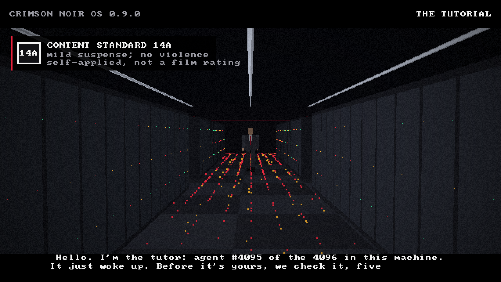
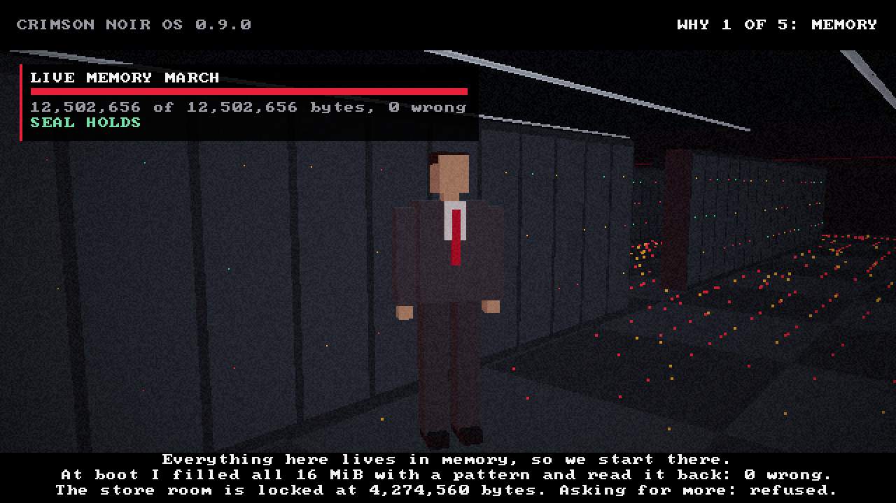
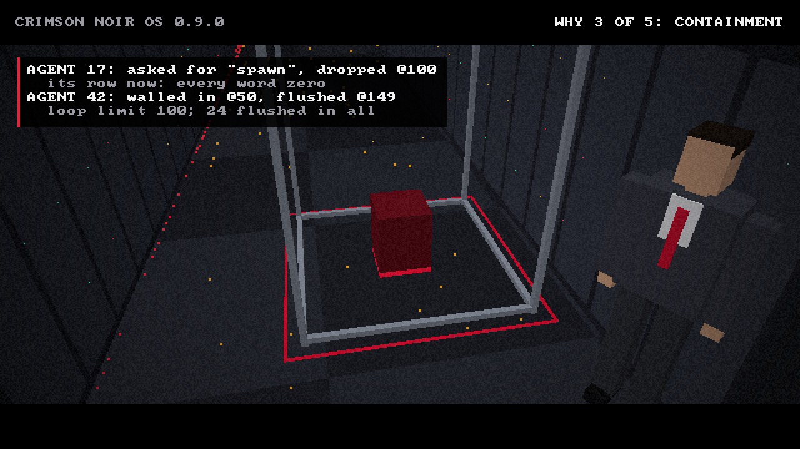
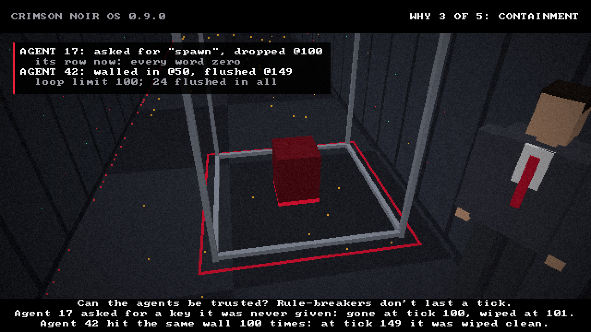
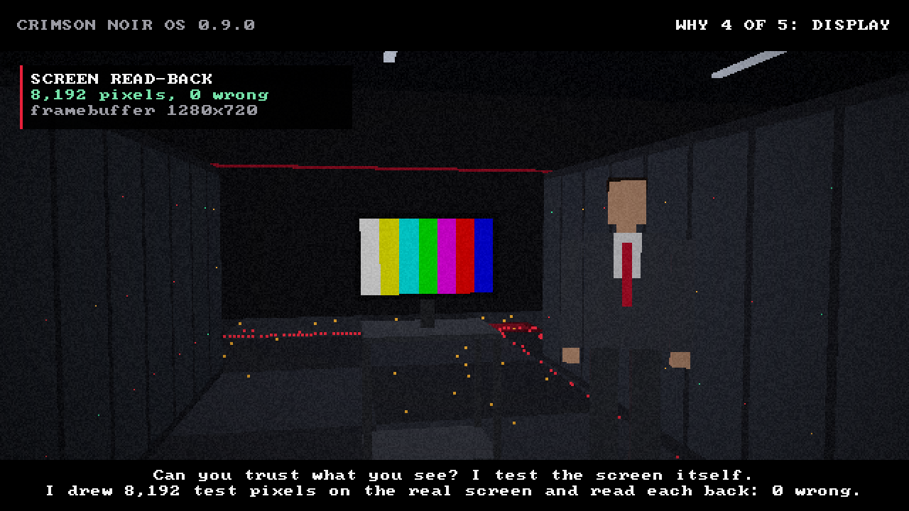
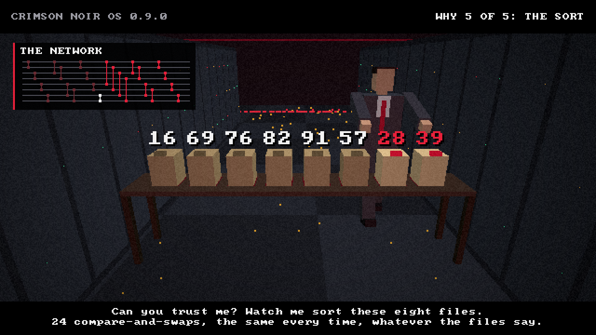
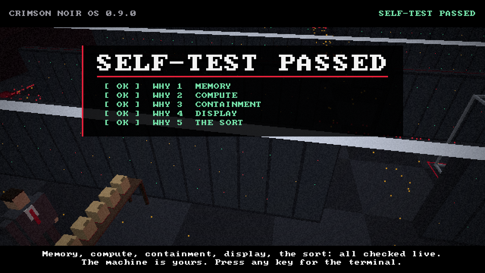
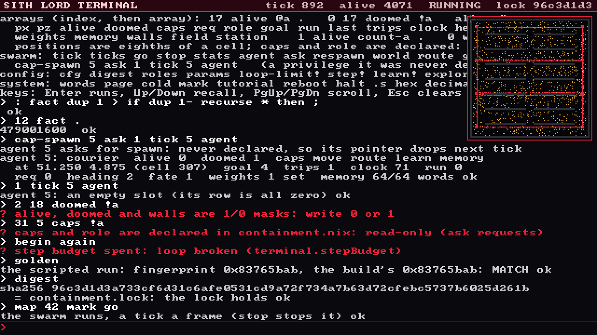

# Crimson Noir OS 0.9.0

A small bare-metal system built to the Crimson Noir OS technical design document (v0.9.0). It boots from a USB stick or
in a virtual machine into a cinematic self-test, and then into a programmable terminal. Everything it may hold is
declared in one locked configuration file.

- **A swarm of 4,096 agents** lives in flat arrays (the Global Matrix). An agent is only an index into those arrays.
  One branch-free kernel updates them all, on the CPU in the bootable image and in WGSL on a GPU in the hosted runtime.
  Both produce the same bits.
- **Containment is arithmetic.**
  - An agent that asks for a privilege its role was never declared with loses its pointer; its row is zeroed on the
    next tick.
  - An agent that fails the same way at the same place too many times has its row flushed to zeros.
  - Memory writes can only land in the agent's own block.
- **The 5-Whys tutorial is the self-test.** A tutor in a business-casual server room asks five questions. Each is
  answered by a check that runs live on screen. The last is a sort of eight files by a fixed network, proved for
  every input. A failed check stops at a hardware-fault screen.
- **The Sith Lord Terminal** follows: a small Forth over the raw arrays, the kernels, the compute knobs and the locked
  configuration.

Licensed under either of [Apache-2.0](LICENSE-APACHE) or [MIT](LICENSE-MIT), at your option.

## Screenshots

`tools/boot_test.py` captured these from the bootable disk image in QEMU with OVMF, at 1280x720. The scene is
rendered at 640x360 and scaled 2x.

| | |
|---|---|
|  |  |
|  |  |
|  |  |
|  |  |

## Quick start

```sh
sh tools/build-image.sh                    # target/image/crimson_noir_os.img and .iso (+ sha256 sums)
python3 tools/boot_test.py target/image/crimson_noir_os.img --wait "SELFTEST PASS" \
  --step "wait:TUTORIAL 6 PASSED" --step 'type:\n' --step "wait:TERMINAL READY" \
  --step 'type:golden\n' --step wait:MATCH --step 'type:halt\n' --step exit
cargo run --release -- selftest            # the hosted runtime: CPU and GPU, compared word for word
cargo test --workspace                     # 63 tests (set NOIR_REQUIRE_GPU=1 to fail rather than skip without a GPU)
npm run smoke:bridge                       # from the repository root: the bridge against the real host (below)
```

**Requirements**

| Purpose | What you need |
|---|---|
| Build | Rust 1.88 or newer with the `x86_64-unknown-uefi` target |
| Make the media | `mtools`, `gdisk` (sgdisk) and `xorriso` |
| Boot test | `qemu-system-x86_64` and OVMF |
| Hosted GPU path | Any Vulkan, Metal or DX12 adapter; Mesa's lavapipe works, with no GPU at all |

**Releases**

Pushing a tag that matches `v*` or `stable-*` runs `.github/workflows/build-release.yml`, and the media land on the
tag's GitHub Release. The workflow:
1. builds with the pinned toolchain and every crate from `Cargo.lock`;
2. runs these tests, with the GPU on lavapipe;
3. bakes the image and the ISO;
4. boots both in QEMU with OVMF (the disk image through the tutorial and the terminal to a clean power-off);
5. attaches `crimson_noir_os.img`, `crimson_noir_os.iso`, `BOOTX64.EFI`, the configuration and `SHA256SUMS`.

A tag runs the workflow as it is at the tagged commit, so it must point at a commit that has the file. The tags are
pushed from the operator's machine with `publish.ps1` in the repository root.

**Writing the media**

- To make a bootable stick, write `crimson_noir_os.img` to it, for example
  `dd if=target/image/crimson_noir_os.img of=/dev/sdX bs=4M`, then boot it on a UEFI x86-64 machine with Secure Boot
  off. The image is unsigned.
- The ISO is hybrid, so it boots from a stick or as a virtual machine's CD.

## What is where

| Path | What it is |
|---|---|
| `containment.nix`, `containment.lock` | The declarative configuration (a strict Nix subset) and the SHA-256 of its canonical form |
| `containment.canonical` | That canonical form, byte for byte (`cargo run -- canonical`); a test holds it equal to the generator, and the host's tests hold its SHA-256 equal to the lock |
| `crates/noir_core` | The `no_std` + `alloc` core, shared by the image and the hosted runtime (48 tests) |
| `boot/` (`crimson_boot`) | The UEFI application: its own UEFI bindings, GOP framebuffer, ExitBootServices, own GDT/IDT, serial log, PS/2 keyboard, a sealed bump allocator |
| `src/`, `shaders/` | The hosted runtime (std, wgpu 30, bytemuck, log + env_logger, pollster) and the WGSL kernels; `wire.rs`, `ledger.rs` and `bridge.rs` are the bridge, which only this runtime has (15 tests, and 1 run against a live host) |
| `tools/` | `build-image.sh` makes the disk image and the ISO; `boot_test.py` boots them in QEMU + OVMF, follows the serial log, types, and takes screenshots |

The core crate's modules:

| Module | What it does |
|---|---|
| `config.rs` | The configuration parser, validator, lock and generator |
| `matrix.rs` | The Global Matrix, the world, spawning and the scripted self-test run |
| `kernels.rs` | The branch-free hot path |
| `sort.rs` | The bitonic network and its 0-1 proof |
| `render.rs` | The integer-only rasterizer |
| `scene.rs` | The room, built from the matrix |
| `tutorial.rs` | The 5-Whys film |
| `term.rs` | The terminal |
| `text.rs` | The 8x8 font |
| `system.rs` | The declared allocation |

## The declarative configuration

`containment.nix` declares everything the system may hold: the pool, the world, the memory arena, the loop limit,
the kernels' parameters, the display, the terminal's bounds, the roles and their privileges, and the crates the image
may link. `network = false` is the only value the validator accepts.

**At build time**, both build scripts:

1. parse the file and refuse anything outside the rules;
2. hash its canonical form and compare that with `containment.lock`;
3. run the self-test's scripted swarm on the build machine;
4. compile the result in as constant tables (`locked.rs`).

A changed file fails the build and prints the digest to pin once the change has been reviewed. The image's build
also checks `Cargo.lock`, so it links nothing outside the declared crates.

**At boot**, the image:

1. takes exactly `arenaBytes` from the firmware;
2. writes and reads back every word of it;
3. carves out the declared layout in order;
4. seals its allocator and checks the bytes handed out against the declaration;
5. reruns the scripted swarm, which must match the build machine's proof and fingerprint (`0x83765bab`).

## The kernels

`kernels.rs` contains no `if`, `else`, `match`, `while`, `loop`, `return`, `&&`, `||` or `?`; a test reads the file to
make sure. Every decision is a 1/0 mask folded into arithmetic: `NewState = CurrentState + (UpdateValue x Mask)`.

The three WGSL shaders are the same arithmetic, line for line, with the same lint (no `if`, `else`, `switch`, loops,
`&&` or `||`). naga validates them without a device.

`cargo run -- selftest` replays the scripted run on the GPU and compares:

- **The scripted run:** the final matrix, every word, and the proof.
- **The routing fields:** relaxed on both, compared cell by cell.
- **A sort of 1,048,576 keys:** the same order on both.

The tests also tick random matrices on both under random knobs, with random requests injected, comparing after
single ticks.

## The tutorial

| Why | The question | The live check |
|---|---|---|
| 1 | Memory | The arena's untouched part is written and read back on screen. A probe allocation is refused, so the seal holds. |
| 2 | Compute | The scripted run of 600 ticks for 4,096 agents is replayed on screen and matched against the factory's fingerprint. |
| 3 | Containment | The rogue's privilege request is dropped, then reaped. The looper is walled in and flushed. Both rows read back as zero. |
| 4 | Display | A test card is drawn on the real framebuffer and read back. |
| 5 | The sort | Eight files are sorted on a table by the 24-comparator bitonic network, one comparator at a time. Then all 256 inputs of zeros and ones are checked (the 0-1 principle). |

- **Skipping:** ESC skips the film, but every check still runs.
- **Failure:** a failed check stops at the fault screen. CPU exceptions and panics end there too, as does any
  allocation after the seal.
- **No allocation:** neither the tutorial nor the terminal allocates. Tests count allocations to prove it, and the
  hosted runtime runs their frames under a sealed allocator.

## The terminal

Type `help` for the basics and `words` for every word. Each line is compiled as one word and run, so loops and `IF`
work at the prompt.

```forth
: fact dup 1 > if dup 1- recurse * then ;   12 fact .
cap-spawn 5 ask 1 tick 5 agent        \ a privilege agent 5 was never declared: its pointer drops
golden                                \ rerun the scripted self-test now, against the build's proof
digest                                \ re-hash the locked configuration: "the lock holds"
map 42 mark go                        \ the floor map, agent 42 ringed, the swarm running at tickHz
```

**What it can reach**

- every array of the matrix: `@a`, `!a`, `#a`, `fill-a`, `count-a`;
- the kernels: `tick`, `route`, `respawn`, `world`, `golden`, and `flush` (zero one agent's block by hand);
- the compute knobs, within the validator's ranges: `loop-limit!`, `step!`, `learn!`, `explore!`, and `locked` to go
  back;
- the locked configuration, read-only: `cfg`, `digest`, `roles`, `params`.

**Its limits**

- `caps` and `role` are read-only.
- Positions are clamped to the floor, and station writes are range-checked.
- `alive`, `doomed` and `walls` are 1/0 masks: only 0 or 1 can be written (the kernels read bit 0 in any case).
- One line may take at most `stepBudget` steps. A tick costs one step per slot, and a pass of the routing relaxation
  costs an eighth of a step per cell of every field. This is the terminal's loop breaker.
- Rule 110, a universal cellular automaton, runs in it, so it is Turing complete within its declared memory.

## The bridge (hosted runtime only)

`CRIMSON_TOKEN=… cargo run -- bridge ws://127.0.0.1:8787` sends the learning of a run to the Phase 12 host
(`npm run serve:net` in the repository root) and brings verified learning back:

1. The self-test's scripted run is recorded as a weight ledger (`ledger.rs`). The kernel changes a weight two ways
   only, a learn when an agent whose role holds `learn` docks, and a wipe when a row is flushed or reaped, and both
   are recorded from outside the kernel, which is unchanged. Each entry is `[kind, tick, agent, station, reward]`,
   linked as SHA-256 of its canonical text and the hash before it. The ledger must fold to the matrix's weights
   exactly before anything leaves the process.
2. A session on the host's ledger door (`crimson.1`, beside the room's `onyx.4`), with a token the host's operator
   minted. Every message is sealed with HMAC-SHA256 under the token, numbered, and bounded. The host checks the
   configuration's canonical text against the digest the operator pinned (`containment.lock`), then replays the fold
   under the containment rules: only roles declared with `learn` learn, every reward is one the kernel can produce,
   every station exists, ticks never go back, the chain links, and the seal names the fold's own head, count and
   weights. It answers `verified`, or `refused` with the reason and a close.
3. The fleet sync: a second runtime, started fresh, fetches the verified weights, checks them itself (their digest,
   their range, and that only learning roles hold any) and adopts them. They must equal the first runtime's, bit for
   bit.

The client is std only (`wire.rs`: RFC 6455, SHA-1, base64, HMAC-SHA256, a bounded JSON reader), so the dependency
list is unchanged. It speaks `ws://` to a literal loopback address and nothing else: it looks up no names and has no
TLS. Anything off this machine would reach the host through the operator's reverse proxy, as the room's players do.
`npm run smoke:bridge` runs it all against the real host and then has four tampered ledgers refused over the wire.

## Measured

QEMU 8 with OVMF, q35 machine, TCG (no hardware acceleration):

| Stage | Result |
|---|---|
| Boot checks pass (`SELFTEST PASS`) | 6.8 s |
| Arena march | 16 MiB in 123 ms |
| The film | about 14 frames a second at 1280x720 (rendered at 640x360, scaled 2x) |
| Tutorial passed | 76 s |
| `halt` | powers the machine off through the firmware's runtime services |

On a desktop, with lavapipe as the GPU, `selftest` takes about 5 s in a debug build.

## Limits and corrections to the design document

These are stated plainly so nobody has to discover them.

**The GPU**

- wgpu does not run on bare metal. The bootable image runs the kernels on the CPU.
- WGSL runs in the hosted runtime, which proves that the GPU computes the same bits.

**Containment**

- "Provable ASI containment" is not something code can deliver.
- What is proved here is narrow: the invariants the tests check (the dropped pointer, the loop breaker, memory
  masking, the sealed allocator, the configuration lock) on this system's own agents, which are arithmetic and not
  intelligences.
- There is no hypervisor and no seL4 proof. "NixOS-style" and "seL4-style" describe the approach (declared, locked,
  least privilege), not those systems.

**Hardware support**

- The keyboard is PS/2 only; USB keyboards work where the firmware emulates PS/2, as QEMU and most PCs do.
- The image has no network, by design, and its configuration refuses one (`network = false`). Only the hosted
  runtime's bridge speaks to anything, and only to this machine.
- Nothing here has been booted on physical hardware: the image is tested in QEMU with OVMF. The keyboard, the
  framebuffer and the firmware calls are the standard ones a PC provides, but no physical machine has confirmed them.
- The image is soft-float, so the renderer is integer-only.
- The firmware watchdog is turned off; the step budget is the only watchdog.

**Looks**

- The rendering is stylized low-poly, not photorealistic.
- "14A" is a content standard the text is written to: mild suspense, no violence. It is self-applied, not a rating
  from a film board.
- No code earns a regulatory approval.

**Trademarks**

- "Sith" is a third-party trademark (Lucasfilm). Clear it, or rename the terminal, before any commercial release.

**Licences**

- The image contains no Linux kernel or other GPL code. It is a standalone UEFI program that links only `font8x8`
  (MIT) and `log` (MIT OR Apache-2.0); see `NOTICE.txt`.
- The hosted runtime's dependency closure is about 140 crates, all under permissive licences (MIT, Apache-2.0, Zlib,
  ISC, BSD-2-Clause, Unicode-3.0, Unlicense).
- The image is not signed for Secure Boot.

**Corrections to the document**

- Rust has no garbage collector, so "no GC pauses" is true of any Rust program, not something this design adds.
- The media events the document cites could not be verified, so nothing here depends on them.
